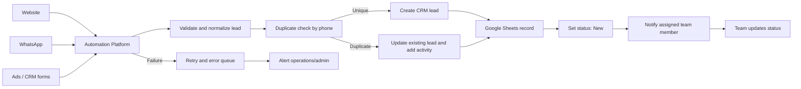

# PROPPR Lead Management Automation

## Task 1: Lead Management Workflow

### Workflow Diagram



### Recommended Stack and Data Flow

Use **n8n** as the central automation platform, Google Sheets as the operational lead register, and HubSpot or Zoho CRM for sales tracking. Website and campaign forms send data through HTTPS webhooks. WhatsApp can use an approved provider such as Twilio, Meta Cloud API, or a WhatsApp Business integration. The provider calls an n8n webhook, n8n normalizes the payload, searches the CRM and sheet by phone number, and creates or updates records through each service's API.

| Incoming field | Normalization |
|---|---|
| Phone | Remove spaces, symbols, country-code variations; use the last 10 digits |
| Name | Trim whitespace and correct repeated spaces |
| Location | Map to a standard value such as Gurgaon or Goa |
| Budget | Convert values such as ₹1.5 Cr into a numeric INR value |
| Enquiry date | Store ISO date/time, e.g. `2026-10-28T19:00:00+05:30` |

### Duplicate Handling

The 10-digit normalized phone number is the unique business identifier. Before creating a CRM record, n8n searches CRM Contacts and/or Lead records for that phone. If one is found, the workflow should update it, append the latest source and enquiry activity, and avoid creating another lead. If none exists, it creates a new CRM record and mirrors it to Google Sheets using the same CRM `Lead ID` as the record key.

A unique source record is stored for each enquiry. For example, IDs 101 and 103 are distinct enquiries from the same person, but they should produce only one CRM lead record.

### Lead Assignment and Statuses

- Normalize and validate required fields; incomplete records enter a review queue.
- Apply location and budget priority rules.
- Assign the lead by preferred location: Gurgaon or Goa team, then balance workload if configured.
- Set the initial CRM status to **New**.
- Notify the owner through email, WhatsApp, or Slack/Teams.
- Team members manually change status to **Contacted**, **Qualified**, or **Closed**.

### Failure Handling

Every execution receives a unique `event_id`. Failed CRM or sheet operations are retried with exponential backoff (for example, after 30 seconds, 2 minutes, and 10 minutes). Persist the original event and error response in an error queue such as a Google Sheet or database. After retries, alert the assigned operations owner and do not replay the event without an idempotency check. This preserves data and prevents duplicate CRM records.

## Task 2: Automation Logic

1. **Potential duplicates:** Leads 101 and 103 are potential duplicates because both are for Rahul Sharma and use normalized phone number `9876543210`. The same number in a different source means this is one person making repeated enquiries, not two distinct customers.
2. **Preventing duplicate CRM records:** Normalize the phone and search CRM and Sheet records using it before creating a lead. If found, update the existing record, record the second enquiry as an activity, and keep its source history. A database unique constraint or CRM deduplication rule can also enforce uniqueness.
3. **Priority flag:** Convert `₹1.5 Cr` to ₹15,000,000 and apply this rule: location is Gurgaon and budget is at least ₹15,000,000. Leads 101 and 103 are priority because both are for Gurgaon with a ₹1.5 Cr budget; lead 104 is also priority with a ₹2 Cr Gurgaon budget. In this deduplicated CRM view, IDs 101 and 104 would appear as priority CRM leads, while 103 remains an enquiry activity linked to 101.
4. **CRM unavailable:** Return an acknowledgement where possible, save the full event in a durable queue, retry with backoff, and alert operations if delivery still fails. Do not accept the same webhook repeatedly as an implicit acknowledgement of success.
5. **Exactly-once retries:** Store a unique `event_id` in a processing table before side effects and mark it `Completed` only after CRM and Sheet writes succeed. A separate CRM lead key (normalized phone) prevents a second lead from being created. The workflow should reconcile partial failures and process failed events once, using idempotent record creation or CRM/upsert.

## Task 3 Option B: Python Script

Run the implementation with:

```bash
python3 lead_processor.py
```

The script reads the four sample leads, groups them by normalized phone number, removes duplicate phone records from the cleaned output, keeps duplicate records separate, and flags priority leads. It uses numeric INR conversion so `Cr` and `Lakh` values are comparable reliably.

## Task 4: Plain-English Explanation

### What the automation does

When somebody submits an enquiry on the website, WhatsApp, or an advertisement, the system collects the person's details, checks whether the same phone number already exists, and saves the record. It also tells the right sales team member and marks high-value Gurgaon enquiries for priority attention.

### How the team uses it

Sales opens the assigned lead in the CRM and moves it through New, Contacted, Qualified, and Closed. The sheet and CRM should show the same record. A repeated enquiry appears as an update or activity on the existing contact rather than a new lead, and team members can review incomplete or uncertain records in a review queue.

### What happens when something goes wrong

The automation tries again automatically. If the CRM or sheet remains unavailable, it stores the enquiry and alerts an operations contact rather than silently losing it. Once service returns, the queued item can be processed safely without creating duplicates.

### Limitations and improvements

Phone numbers can be entered in different formats, customers may share a phone number, and people may legitimately enquire from several numbers. Future improvements could add consent and contact verification, allow merging records with a reviewed process, use a true CRM database as the system of record, add role-based access and audit logs, and monitor SLA breaches for unanswered leads.