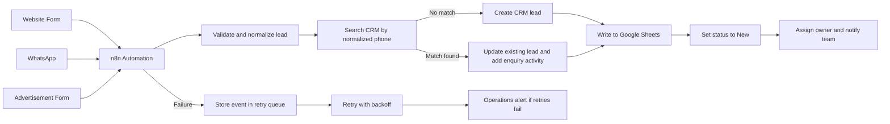

# PROPPR - Task 1: Lead Management Automation Workflow

## Recommended Workflow

## Tools and Communication

- **n8n:** Central automation platform.
- **Google Sheets:** Operational lead register.
- **CRM:** HubSpot or Zoho for contact and sales management.
- **Website and campaign forms:** Send lead data to secure n8n HTTPS webhooks.
- **WhatsApp Business provider:** A provider such as Twilio, Meta Cloud API, or an approved integration sends incoming messages to n8n.

n8n receives each payload through its webhook, normalizes it, calls the CRM API for duplicate checks and record creation, and writes the resulting CRM lead ID to Google Sheets.

## Data Captured

- Name
- Phone number
- Lead source
- Preferred location
- Budget
- Enquiry date
- Automation event ID for reliability

## Normalization Rules

| Field | Rule |
|---|---|
| Phone | Remove spaces, symbols, and formatting; retain the last 10 digits |
| Name | Trim whitespace and collapse repeated spaces |
| Location | Standardize values such as `Gurgaon` and `Goa` |
| Budget | Convert to a numeric INR value |
| Enquiry date | Store as ISO 8601 with timezone |

## Duplicate Handling

The normalized 10-digit phone number is the primary business identifier. Before creating a CRM record, n8n searches for an existing contact or lead.

- **No match:** Create one CRM lead and add a matching Google Sheets row.
- **Match found:** Update the existing CRM contact/lead, add the latest enquiry and source as an activity, and do not create another CRM lead.
- **Phone number already used by a different person:** A team member can merge or review the record manually; a phone-only rule is an efficient first check, not an automated certainty.

## Assignment and Follow-up Statuses

1. Validate required fields. Invalid or incomplete records go to a review queue.
2. Apply location and priority rules.
3. Assign by preferred location, then by team workload when configured.
4. Set status to `New`.
5. Notify the assigned owner by email, Slack/Teams, or WhatsApp.
6. The sales team updates the status to `Contacted`, `Qualified`, or `Closed`.

## Failure Handling

Every source event receives a unique `event_id`. CRM and Sheet operations use retries with exponential backoff, such as 30 seconds, 2 minutes, and 10 minutes. The original payload and error details remain in a durable queue or error sheet.

After retries fail, operations should receive an alert. A failed lead must never be silently dropped, retried without an idempotency check, or processed without reconciliation of partial CRM and Sheet writes.
